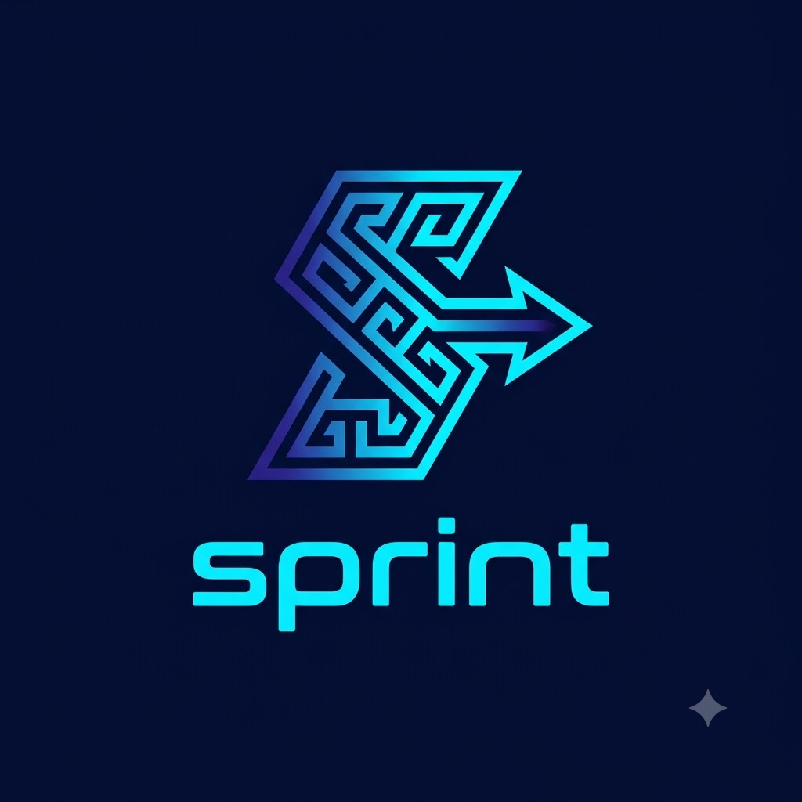

<p align="center">
  
</p>

<h1 align="center">Sprint — Agile Project Management</h1>

<p align="center">
  <strong>Plan, ship, repeat.</strong> A full-stack agile workspace with Jira-style sprints, boards, and a durable notification engine — built contract-first.
</p>

<p align="center">
  <a href="https://sprint-app-ten.vercel.app">🌐 Live App (full product)</a> ·
  <a href="https://youtu.be/Sumf3ThXkvk">🎥 Overview Video</a> ·
  <a href="https://youtu.be/ZmLD1TLM-WE">🎥 Demo Video</a>
</p>

---

## ✨ What is Sprint?

Sprint is a solo full-stack agile project management platform demonstrating modern software architecture patterns. A single **OpenAPI specification** drives everything: server-side Zod validation and frontend TanStack Query hooks are **generated from the same contract**, so the API and UI can never drift.

On top of that foundation sits a **Jira-style delivery engine** — sprints, kanban boards, epics, comment mentions, burndown analytics — backed by a durable, event-sourced notification pipeline with multi-instance worker safety and exponential-backoff retries.

## 🚀 Feature Highlights

### Core workspace
- **Projects** with keys, owners, status lifecycle, and team roles (admin / member)
- **Stories → Tasks hierarchy** with acceptance criteria, priorities, story points, labels, and assignees
- **Dashboard** — aggregated counts, task status breakdown, and a live activity feed (single-query, ~0.4s)

### Agile delivery *(Jira-style)*
- 🏃 **Sprints** — plan, start (one active sprint per project), and complete; unfinished stories roll back to the backlog automatically
- 📋 **Kanban board** — drag-and-drop across Ready / In progress / Review / Done with WIP-limit warnings and quick filters (search, type, assignee)
- 🎯 **Backlog management** — drag stories between the backlog and sprints, reorder by rank
- 🧩 **Epics** — group stories with automatic story/point roll-ups
- 🐞 **Issue types** — story / bug / spike, each with priority and labels

### Collaboration & reliability
- 💬 **Comments with @mentions** — typing `@akash` resolves the member directory and fans the mention out through the durable email outbox (spam-capped)
- 📬 **Durable notification outbox** — emails survive restarts, use `FOR UPDATE SKIP LOCKED` for multi-instance safety, and retry with **exponential backoff + jitter**
- 📊 **Burndown reports** — remaining vs ideal story points per day, per sprint
- 🔐 **Clerk authentication** — Google OAuth + email, protected API routes, production-ready session handling

## 🏗 Architecture: Contract-First Development

```
lib/
├── api-spec/          # OpenAPI contract — the single source of truth
│     │ codegen (orval)
├── api-zod/           # → generated server validation schemas
├── api-client-react/  # → generated TanStack Query hooks
└── db/                # Drizzle ORM schemas & migrations (Neon Postgres)

artifacts/
├── agile-pm/          # React 19 + Vite frontend (Jira-style UI)
├── api-server/        # Express 5 REST API + notification worker
└── mockup-sandbox/    # Design system sandbox

clerk-nextjs/          # Next.js 16 marketing site + app shell (Vercel)
```

**Why contract-first?** Changing `openapi.yaml` regenerates both sides of the wire. Integration bugs from shape drift are eliminated **by construction**, not by discipline.

## 🛠 Tech Stack

| Layer | Technology |
|-------|-----------|
| Frontend | React 19, Vite 7, TanStack Query, wouter, shadcn/ui, TailwindCSS 4 |
| Marketing site | Next.js 16, Tailwind 4, react-bits (WebGL hero) |
| Backend | Express 5, Node.js 20+ |
| Database | PostgreSQL (Neon serverless), Drizzle ORM |
| Validation | Zod — generated from OpenAPI |
| Authentication | Clerk (Google OAuth + email) |
| Email | Nodemailer worker with exponential backoff + jitter |
| Logging | pino + pino-http |
| Tooling | pnpm workspaces, TypeScript 5.9 project references |

## 🗄 Data Model

`members` · `projects` · `epics` · `sprints` · `stories` · `tasks` · `comments` · `notifications` (outbox) · `activity_events` (audit feed)

Full Drizzle schemas live in [`lib/db/src/schema/`](lib/db/src/schema). All migrations are additive and applied with `drizzle-kit push`.

## 🚦 Getting Started

```bash
# 1. Install
pnpm install

# 2. Configure environment (see .env.example files)
#    - DATABASE_URL  (Neon Postgres)
#    - Clerk keys    (VITE_CLERK_PUBLISHABLE_KEY)
#    - SMTP creds    (notification worker)

# 3. Push the schema to your database
pnpm --filter @workspace/db push

# 4. Regenerate the API contract (after editing openapi.yaml)
pnpm --filter @workspace/api-spec codegen

# 5. Run API + frontend together
pnpm dev
#    API  → http://localhost:3000/api
#    Web  → http://localhost:4173
```

> **Local auth mode:** comment out `VITE_CLERK_PUBLISHABLE_KEY` in `artifacts/agile-pm/.env` to develop without a Clerk account (a local demo sign-in form is used instead).

## 🔐 Security Notes

- Every API route sits behind Clerk authentication (`requireAuth`)
- All inputs validated with generated Zod schemas at the boundary
- 100% parameterized queries via Drizzle — no string-built SQL
- Business rules enforced server-side (e.g. `409` on illegal sprint transitions)
- @mention fan-out is capped per comment to prevent outbox abuse

## ⚡ Performance Notes

- Dashboard aggregates computed in **one SQL round trip** (~0.4s, down from 9.8s)
- **Route-level code splitting** — main bundle 1,079 KB → **415 KB** (−62%); pages load on demand
- **Fully cloud-hosted** — frontend + API on Vercel, no local server needed
- WebGL hero lazy-loaded after first paint on the marketing site
- Composite database indexes (project/sprint/rank, task, comment, notification lookups)
- Additive-only migrations; Neon serverless with pooled connections

## 📺 Walkthroughs

- [Project overview, architecture & key features](https://youtu.be/Sumf3ThXkvk)
- [Live demo](https://youtu.be/ZmLD1TLM-WE)

## ☁️ Deployment

The full product runs in the cloud — **no local server required**:

- **App (frontend + API):** https://sprint-app-ten.vercel.app — Vercel (static SPA + Express as a serverless function, same-origin `/api`)
- **Database:** Neon serverless Postgres
- **Auth:** Clerk (Google OAuth + email)

Deploy updates with:
```bash
pnpm --filter @workspace/agile-pm run build:cloud   # bundles frontend + API
cd artifacts/agile-pm/deploy && vercel --prod       # ships it
```

## 🗺 Roadmap

- [ ] Atomic issue keys (`SPR-1`) + LexoRank O(1) drag ordering
- [ ] Optimistic concurrency (version locks) & workflow transition engine
- [ ] Field-level issue history / audit log
- [ ] Velocity, cumulative-flow & control charts
- [ ] Time tracking & worklogs
- [ ] Issue linking (blocks / relates to), release hub, saved filters

## 📄 License

Built by [Akash Gupta](https://github.com/akashgupta221). Sprint is in active development — free while in development, pricing will be announced here first.
